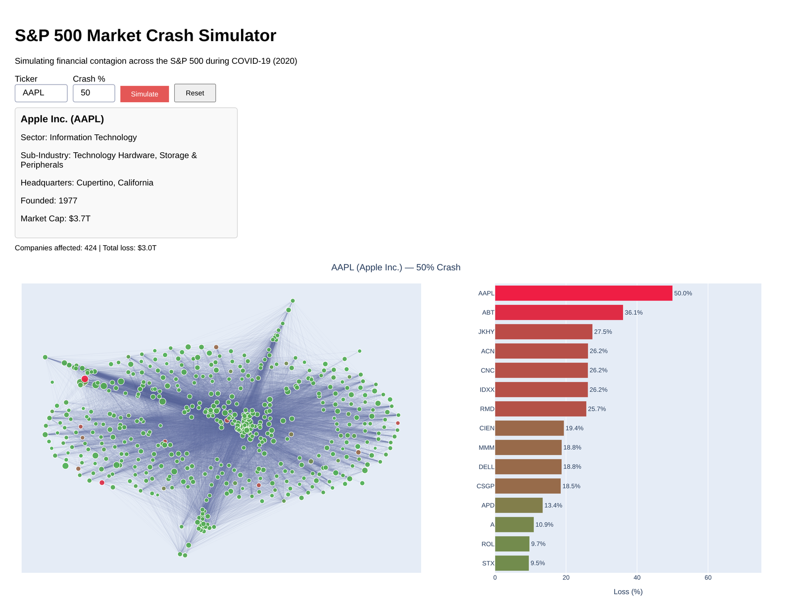

# S&P 500 Contagion Simulator

**Crash one company and watch the shock spread through the S&P 500.**

**[▶ Live demo](https://sp500-contagion-simulator.onrender.com)** (free hosting, so the first load can take about a minute)



When a major company crashes, the damage rarely stays contained. This project models the S&P 500 as a weighted graph: 503 companies, linked wherever their stock prices moved together during the COVID-19 crash in 2020. Pick a company and a crash size, and the simulator traces how the loss travels through those links and which companies take the biggest hit.

*Example:* a 50% crash of Apple reaches **424 of 503 companies** and wipes out about **$3.0T** in simulated market value.

## How it works

**1. Build the network.** Daily adjusted closing prices (Jan 2 to Aug 18, 2020) are turned into log-returns. Two companies are connected if the Pearson correlation of their returns is **r ≥ 0.7**, with the correlation as the edge weight. That gives 503 nodes and about 24,900 edges.

**2. Spread the shock.** The crashed company loses the chosen percentage of its market cap. Each neighbour is then hit by `crash % × correlation`, and the shock keeps spreading recursively until it falls below 1%. Each company is hit at most once.

**3. Show the result.**
- Network graph: green = unaffected, red = hit (darker = worse), star = the company that crashed first.
- Bar chart of the 15 hardest-hit companies.
- Totals for companies affected and market value lost, plus an info card for the crashed company.

## Run it locally

```bash
git clone https://github.com/arnabkk/sp500-contagion-simulator.git
cd sp500-contagion-simulator
python3 -m venv .venv && source .venv/bin/activate
pip install -r requirements.txt
python main.py
```

Open http://127.0.0.1:8050, enter a ticker (e.g. `AAPL`) and a crash percentage (e.g. `50`), then click **Simulate**. **Reset** returns to the baseline graph.

## Project structure

| File | What it does |
|---|---|
| `classes.py` | Graph model: `Company`, `MarketNetwork`, correlation edges, crash simulation |
| `visualization.py` | Dash app and Plotly figures (`create_app` builds the app) |
| `main.py` | Runs the app locally |
| `app.py` | Production entry point for gunicorn (`gunicorn app:server`) |
| `data_fetcher.py` | Builds the dataset from Wikipedia's S&P 500 list and yfinance |
| `sp500_covid_data.json` | Pre-fetched dataset, so the app runs without any API calls |
| `render.yaml` | Deployment config for Render |

## Tech stack

Python · NetworkX · NumPy · Plotly / Dash · yfinance · gunicorn · Render

## Limitations

- Correlation isn't causation. Two stocks moving together in 2020 doesn't mean one would drag the other down.
- The spread is recursive and depth-first, and a company is only hit the first time the shock reaches it. That means a company's loss depends on which path reaches it first, not necessarily the strongest one.
- Correlations come from 2020 prices, but market caps are from when the dataset was last fetched (April 2026). Dollar losses are illustrative.

## Team

Built as the final project for University of Toronto course (Winter 2026) by Arnab Karmokar, Brian Chang, Derek Sun and Johnny Li. Forked from [Toros-25/S-P-500-Market-Crash-Simulator](https://github.com/Toros-25/S-P-500-Market-Crash-Simulator), with deployment added since.

<details>
<summary>References</summary>

1. Kenton, W. "S&P 500 Index." *Investopedia*. [Link](https://www.investopedia.com/terms/s/sp500.asp)
2. Gratton, P. "The Fall of the Market in the Fall of 2008." *Investopedia*. [Link](https://www.investopedia.com/articles/economics/09/subprime-market-2008.asp)
3. Frazier, L. "The Coronavirus Crash of 2020." *Forbes*, 2021. [Link](https://www.forbes.com/sites/lizfrazierpeck/2021/02/11/the-coronavirus-crash-of-2020-and-the-investing-lesson-it-taught-us/)
4. "Introduction to Graphs." *GeeksforGeeks*. [Link](https://www.geeksforgeeks.org/dsa/introduction-to-graphs-data-structure-and-algorithm-tutorials/)
5. "Basic Object Oriented Data Model." *GeeksforGeeks*, 2021. [Link](https://www.geeksforgeeks.org/dbms/basic-object-oriented-data-model/)
6. *NetworkX Documentation*. [Link](https://networkx.org/documentation/stable/)
7. "What Is YFinance Library?" *GeeksforGeeks*, 2025. [Link](https://www.geeksforgeeks.org/machine-learning/what-is-yfinance-library/)
8. "Pearson Correlation Coefficient." *GeeksforGeeks*. [Link](https://www.geeksforgeeks.org/maths/pearson-correlation-coefficient/)
9. "What Is NetworkX?" *NVIDIA Glossary*. [Link](https://www.nvidia.com/en-us/glossary/networkx/)
10. Holtz, Y. "Plotly." *The Python Graph Gallery*. [Link](https://python-graph-gallery.com/plotly/)

</details>
